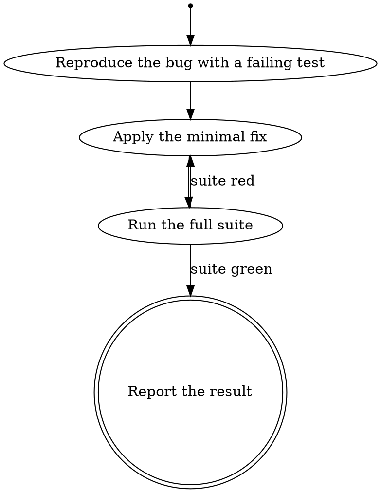
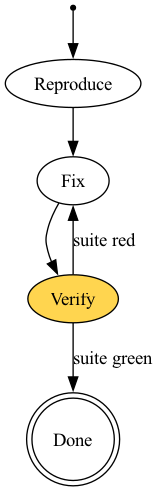

# state-machine

A skill that makes a coding agent work a task by following a state machine drawn as a Graphviz DOT file. The graph is the program and the agent is its interpreter: it does the current state's work, moves only along an edge, and stops and reports when the task no longer fits the graph.

Written for Claude Code. The `sm` tool underneath is plain Python with no dependencies and does not depend on any agent.

- The order of work lives in a file you can read and edit, not in the agent's context.
- The position is stored on disk, so it survives context compaction and new sessions.
- An edge can carry a shell command (`check`); the tool refuses the move unless it exits 0.
- When the task does not fit the graph, the agent stops and writes `BLOCKED.md` with a proposed change to the graph.

## Install

```sh
git clone https://github.com/coldstar96/state-machine-skill ~/.claude/skills/state-machine
```

For one project only, clone into `.claude/skills/state-machine` inside that project.

Requires Python 3.9 or newer on a POSIX system (`sm` uses `fcntl`). Graphviz (`dot` on `PATH`) is needed only for `sm png`.

## Use

Ask for it in your own words, for example: "Fix the failing test, and work it as a state machine." The agent drafts `machine.dot`, shows it to you with a walk-through, waits for your go-ahead, then follows it.

A machine is a directory holding `machine.dot`:



`sm show` prints it as pseudocode (`--outline` gives the older tree view):

```
fix_bug
  @reproduce:  "Reproduce the bug with a failing test"
  LOOP
    @fix:        "Apply the minimal fix"
    @verify:     "Run the full suite"
      IF (suite green)  ⚙ npm test  BREAK
      IF (suite red)  CONTINUE
  @done:       "Report the result"  END
```

`LOOP` repeats its body; `BREAK` jumps to the first line after the loop, `CONTINUE` back to its top; `GOTO @x` jumps to the state labeled `@x:`. Quoted text is the state's instruction, `( )` holds the condition for a move, and `⚙` is the check command that must pass; `END` marks a final state.

`sm png` draws the same machine with Graphviz, with the current state filled in (here the run is at `verify`):



Every move prints where the agent now is:

```
[fix_bug] fix · step 1 · visit 1 — Apply the minimal fix
exits: verify
rule: only this state's work; if it does not fit, stop and report (BLOCKED.md), no jump, no graph edits
```

You can change the machine at any time, also in the middle of a run: edit `machine.dot` yourself, or tell the agent what to change and it makes that edit. `sm` notices on the next command, reports what changed, and the agent continues from the same state.

## The graph format

A restricted subset of DOT:

- A state is a node; its `label` is the instruction for that state.
- The entry is one `shape=point` node with a single edge to the first state.
- A final state has `shape=doublecircle`. A machine with no final state runs until stopped.
- An edge `label` is the condition for taking it. Every exit of a state with more than one exit needs one.
- An edge `check="<command>"` is run in the working directory given to `sm init`; the move is allowed only if it exits 0.

## Commands

`sm` is `python3 <skill directory>/sm.py`.

| Command | What it does |
|---|---|
| `sm new <slug> [--from <path>]` | Create a dated directory for a new machine and print its path; `--from` copies a stored machine's `machine.dot` into it |
| `sm validate [dir]` | Parse and check the machine |
| `sm show [dir]` | Print the machine as pseudocode, with the current state marked (`--outline` for the tree view) |
| `sm png [dir]` | Draw the machine with Graphviz |
| `sm init <dir> --cwd <dir> [--set name=value]` | Start a run, optionally with variables set |
| `sm use <dir>` | Point this session at an existing run |
| `sm now` | Print the current state, its instruction and its exits |
| `sm go [state] [-m reason]` | Move along an edge |
| `sm jump <state> -m reason` | Move to any state, ignoring edges (logged) |
| `sm finished <dir>...` | Exit 0 if every listed run is at a final state; otherwise list the ones that are not |
| `sm set <name> <value>` | Set a variable |
| `sm push <name> <value>...` | Append values to a list variable |
| `sm pop <name> <into> [--last]` | Move a list's first (or last) value into another variable |
| `sm get [--run dir] <name>` | Print a variable, from this run or another |
| `sm log [--vars]` | Print recent moves; `--vars` also lists variable changes |
| `sm config [key value]` | Show or change settings |

`SM_RUN=<dir>` points a single `sm` call at that run, without changing the session's active machine.

A run can hold variables. `{name}` in a state's label is filled in when it is printed, and a check sees each variable as `$name`. Values are plain text in `state.json` and the history, so do not store secrets.

## Configure

Settings live in `config.json` under `SM_HOME` (default `~/.claude/state-machines`). `sm config` shows them; `sm config <key> <value>` sets one; an empty value removes it.

| Key | Meaning | Default |
|---|---|---|
| `dir` | Where `sm new` creates machine directories | `SM_HOME` |
| `on_move` | Shell command run after every state change | none |

`on_move` runs in the machine directory with `SM_STATE`, `SM_MACHINE`, `SM_DIR` and `SM_STEP` set. Its output is discarded, it is stopped after 10 seconds, and a failure never affects the move. For example, to keep the current state in a file a status line can read:

```sh
sm config on_move 'echo "$SM_MACHINE: $SM_STATE" > ~/.sm-status'
```

## Files in a machine directory

| File | Content |
|---|---|
| `machine.dot` | The graph. Yours to edit. |
| `state.json` | Current state, step count, visits |
| `history.jsonl` | Every move and every graph edit |
| `machine.applied.dot` | The graph as last accepted, used to detect edits |
| `BLOCKED.md` | Written by the agent when it had to stop |

## What is enforced

The tool enforces the position, the edges and the checks: a move that is not an edge, or whose check fails, is refused. That the agent calls `sm` at all, and does only the current state's work, comes from the skill text, not from the tool.

## Tests

```sh
python3 -m unittest discover -s tests
```

## Git hooks

`.githooks/post-commit` pushes every commit on a branch to `origin` in the background (log: `.git/auto-push.log`). Install it once per clone:

```sh
cp .githooks/post-commit "$(git rev-parse --git-common-dir)/hooks/"
```

## License

MIT. See `LICENSE`.
