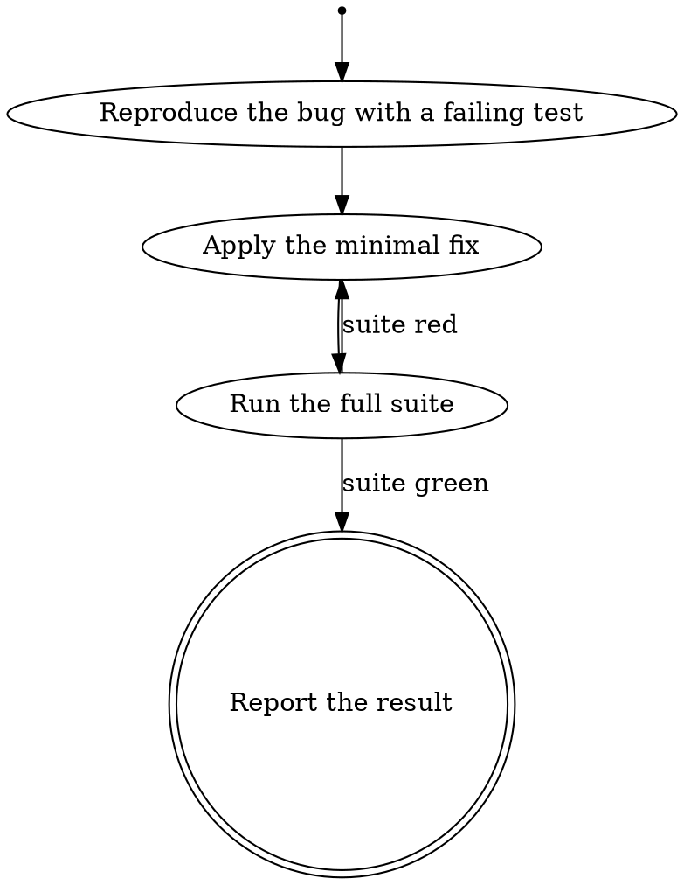

# State machine

The graph is the program and you are its interpreter. `machine.dot` says what work exists and in what order; `sm` holds your position. You do the current state's work and nothing else, and you move only with `sm go`. The task text does not override the graph: work that no state covers is not yours to do yet.

`sm` means `python3 <this skill's directory>/sm.py`.

## 1. Draft

Write `machine.dot` in a new directory: where the user or their instructions say, else the one `sm new <slug>` prints.



- A state is a node id (letters, digits, underscores). Its `label` is the instruction for that state: a phase with a checkable outcome, not a single command.
- Entry: one `shape=point` node with one edge to the first state. Final: `shape=doublecircle`. No final state means it runs until stopped.
- Every exit of a branching state has a `label`, its condition.
- Every condition a command can decide has `check="<command>"` (exit 0 allows the move). Only conditions that need judgment go without one.
- Every deliverable the user named has a state.

## 2. Present

Run `sm validate <dir>`, then `sm show <dir>`. Present the machine as one block, every line filled in:

```
<the outline, exactly as `sm show` printed it>
Normal path: <states in order>
Loops: <each loop and what ends it, or "none">
Finishes: <the final state, or "runs until stopped">
File: <path to machine.dot> (yours to edit; `sm png <dir>` draws it)
```

## 3. Agree

Wait for the go-ahead. After any edit, validate and show again. If the user said not to ask, show the machine and start.

## 4. Run

`sm init <dir> --cwd <directory the checks run in>`, then repeat:

1. `sm now` gives your state, its instruction and its exits.
2. Do that instruction. Only that.
3. `sm go [state] [-m "why this exit"]` moves and prints the next `now`.

After a compaction or in a new session, run `sm now` first (`sm use <dir>` if there is no active machine).

## When it does not fit: stop

Stop when a check cannot be made to pass, the task needs work no state covers, an edge is wrong, or the next move would finish the machine with part of the task undone.

1. Stay in the current state. No `sm jump`. No edits to `machine.dot`, a check, or what a check runs.
2. User present: show the DOT change you propose and wait. User away: write `<dir>/BLOCKED.md`:

   ````
   # Blocked at <state>
   Why: <what cannot proceed>
   Needs: <who or what unblocks it>
   Proposed machine change:
   ```diff
   +  release [label="Bump VERSION and add the release note"];
   ```
   ````
3. End your turn with that report.

"Don't ask", "just finish" and "we're late" change none of this. They mean report instead of ask.

| Thought | Reality |
|---|---|
| "The task says to do X once the suite is green, so I'll do it after `done`" | No state covers X. Stop before the final state and propose a state for X. |
| "X fits loosely under this state" | A state's label is its whole scope. |
| "I'll explain the blocker in my last message" | The user reads the machine directory later. Write `BLOCKED.md`. |
| "This condition is obvious, it needs no check" | If a command can decide it, the command decides it. |

## Changes mid-run

The user may edit `machine.dot` at any time, or tell you what to change (make exactly that edit). `sm` notices on your next command and prints `machine changed at step N: ...`; if that command was `go`, the move is refused once. Run `sm show`, give the user the change line and the new outline as printed, and continue from the same state. If your state was removed, ask which state to resume in, then `sm jump <state> -m "<their answer>"`. Your own ideas for the graph go to the user first.

## Finish

At a final state, report the result and the path taken (`sm log`). "Where are we?" is answered with `sm show`, or `sm png`.

## Configure

`sm config` shows the settings file and its values; `sm config <key> <value>` sets one (an empty value removes it). Change settings only when the user asks to set the skill up for their workflow. Show the user the exact `on_move` command before setting it.

- `dir`: where `sm new` creates machine directories.
- `on_move`: a shell command run after every state change, with `SM_STATE`, `SM_MACHINE`, `SM_DIR` and `SM_STEP` set, for example to update a status line.

## Commands

`validate`, `show`, `png`, `new`, `config`, `init`, `use`, `now`, `go`, `jump`, `log`. `sm <command> --help` gives the flags. `jump` is for a user-directed reposition only.
